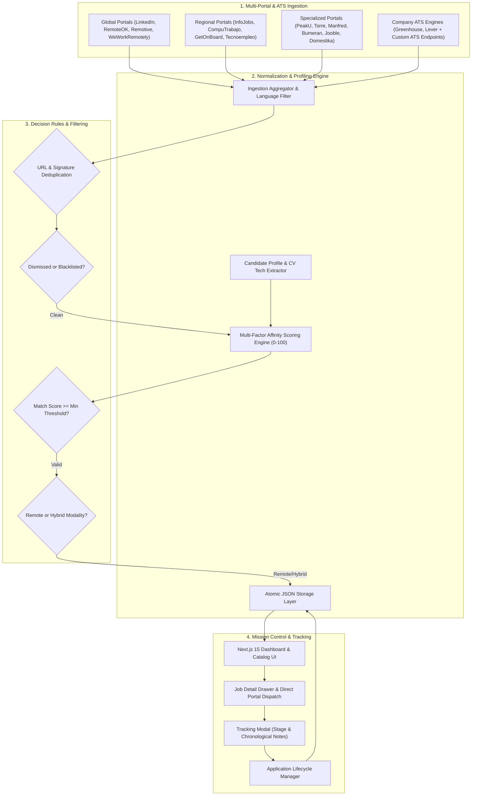

# 🌐 SIFT System — Autonomous Job Ingestion, Matching & Application Tracking Platform

[](https://nextjs.org/)
[](https://react.dev/)
[](https://tailwindcss.com/)
[](https://www.typescriptlang.org/)
[](https://nodejs.org/)

**SIFT System** is an enterprise-grade, high-throughput job ingestion, algorithmic matching, and application lifecycle tracking platform. Architected on **Next.js 15 (App Router)** and **React 19**, it aggregates technical employment vacancies across **20+ international job portals and company ATS systems**, calculates deterministic candidate affinity scores based on dynamic CV technology profiles, and provides an executive mission-control dashboard for managing recruitment pipelines and interview stages.

---

## 📖 1. Core Abstract & Functional Overview

SIFT System streamlines technical career discovery and recruitment pipeline governance by unifying job scraping, algorithmic stack evaluation, and comprehensive application tracking in an ultra-responsive web interface.

### 🌟 Feature Matrix

| Feature Domain | Capability | Description |
| :--- | :--- | :--- |
| **Multi-Portal Ingestion** | 20+ Specialized Connectors | Concurrently extracts vacancies from **LinkedIn** (Spain & Colombia), **InfoJobs**, **CompuTrabajo**, **GetOnBoard**, **Tecnoempleo**, **Remotive**, **RemoteOK**, **PeakU**, **Torre**, **Manfred**, **Bumeran**, **Empleate**, **Jobatus**, **Talent**, **Google Jobs**, **Domestika**, **Jooble**, **WeWorkRemotely**, and ATS systems (**Greenhouse**, **Lever**). |
| **Candidate Profile & CV Engine** | Automated Tech Stack Extraction | Ingests candidate resumes (PDF or raw text) via an in-memory stream parser, extracting key technical competencies, years of experience, and contact metadata to configure the user profile. |
| **Algorithmic Affinity Matching** | Multi-Factor Compatibility Scoring | Evaluates vacancies against candidate technical skills using a deterministic scoring engine (0–100) that weights title keywords, core frontend stack, resume skill overlaps, remote/hybrid modality, and language fit. |
| **Application Lifecycle Tracker** | End-to-End Pipeline Tracking | Organizes candidate applications into actionable recruitment stages (**POSTULADA**, **EN_PROCESO**, **ENTREVISTA**, **OFERTA**, **RECHAZADA**) with chronological interview notes and compensation tracking. |
| **Opportunity Dismissal & Deduplication** | Persistent Blacklist Registry | Normalizes vacancy URLs and requisition signatures to prevent duplicate entries while maintaining a persistent dismissal registry to filter out unwanted roles. |
| **Platform & ATS Governance** | Granular Source Administration | Offers instant toggle controls for every search portal, bulk activation switches, and the capability to dynamically add custom corporate ATS endpoints (Greenhouse/Lever). |
| **Mission Control Dashboard** | Next.js 15 Executive UI | Modern dark-mode interface featuring real-time KPI metrics, a searchable and filterable job catalog with an interactive detail drawer, and dedicated application management views. |

---

## 🚀 2. Architectural Runtime Flow



---

## 📁 3. Annotated Directory Tree

```text
sift-system/
├── .agents/                                # AI Architect standards and engineering protocols
│   ├── AGENTS.md                           # Enterprise Next.js 15 & React 19 rules
│   └── skills/                             # Modular engineering skill guides
├── public/                                 # Static public assets
│   └── cv/                                 # Candidate resume artifacts (PDF / text)
├── src/
│   ├── app/                                # Next.js 15 App Router presentation layer
│   │   ├── api/                            # RESTful API route handlers
│   │   │   ├── applications/route.ts       # Application registry, stage updates & tracking notes
│   │   │   ├── ingestion/run/route.ts      # Multi-portal ingestion pipeline trigger
│   │   │   ├── jobs/dismiss/route.ts       # Vacancy dismissal and blacklisting
│   │   │   ├── jobs/route.ts               # Ingested vacancies catalog endpoint
│   │   │   ├── platforms/route.ts          # Portal & custom ATS company management
│   │   │   ├── profile/route.ts            # Candidate profile query and persistence
│   │   │   └── profile/parse-cv/route.ts   # In-memory PDF / text resume technology extractor
│   │   ├── applications/page.tsx           # Applications tracker (Table & List views with notes)
│   │   ├── jobs/page.tsx                   # Searchable job board with filters and detail drawer
│   │   ├── settings/page.tsx               # Candidate profile editor & platform configuration
│   │   ├── globals.css                     # Tailwind CSS v4 design tokens and theme rules
│   │   ├── layout.tsx                      # Root application shell and header navigation
│   │   └── page.tsx                        # Executive overview dashboard with KPI metrics
│   ├── modules/                            # Domain-driven core modules
│   │   ├── cv-engine/                      # Candidate profile defaults and technology extractor
│   │   │   ├── candidateMasterProfile.ts   # Master candidate default competencies
│   │   │   └── techExtractor.ts            # Regex and token-based tech extraction utility
│   │   ├── ingestion/                      # Multi-portal scrapers, filters, and company registry
│   │   │   ├── companyRegistry.ts          # Default curated company ATS registry
│   │   │   ├── languageFilter.ts           # Language evaluation and Spanish detection
│   │   │   ├── ingestionService.ts         # Central pipeline orchestration & scoring
│   │   │   └── connectors/                 # 20+ specialized connector modules
│   │   │       ├── bumeranConnector.ts
│   │   │       ├── computrabajoConnector.ts
│   │   │       ├── domestikaConnector.ts
│   │   │       ├── empleateConnector.ts
│   │   │       ├── getonboardConnector.ts
│   │   │       ├── googleConnector.ts
│   │   │       ├── greenhouseConnector.ts
│   │   │       ├── infojobsConnector.ts
│   │   │       ├── jobatusConnector.ts
│   │   │       ├── joobleConnector.ts
│   │   │       ├── leverConnector.ts
│   │   │       ├── linkedinConnector.ts
│   │   │       ├── manfredConnector.ts
│   │   │       ├── peakuConnector.ts
│   │   │       ├── remoteokConnector.ts
│   │   │       ├── remotiveConnector.ts
│   │   │       ├── talentConnector.ts
│   │   │       ├── tecnoempleoConnector.ts
│   │   │       ├── torreConnector.ts
│   │   │       └── weworkremotelyConnector.ts
│   │   └── storage/                        # Atomic JSON persistence service
│   │       └── jsonStorage.ts              # Thread-safe read/write operations for storage files
│   └── shared/                             # Atomic design system and reusable utilities
│       ├── lib/utils.ts                    # Class name merging utility (clsx + tailwind-merge)
│       ├── types/index.ts                  # Canonical TypeScript domain interfaces
│       └── ui/                             # Modular Atomic UI library
│           ├── atoms/                      # Badge, Button, Card, Input, MatchScorePill, Switch
│           ├── molecules/                  # FormField, SearchBar, StatCard, ViewModeToggle
│           └── organisms/                  # ApplicationTable, HeaderNavbar, JobCard, JobDetailDrawer, JobTable, TrackingModal
├── storage/                                # Persistent file-based JSON data stores
│   ├── applications.json                   # Tracked applications and interview progress notes
│   ├── candidate_profile.json              # Active candidate details and technology stack
│   ├── dismissed_jobs.json                 # Dismissed job vacancy registry
│   ├── jobs.json                           # Ingested and scored vacancies
│   └── platforms.json                      # Portal toggles and custom company ATS configurations
├── .env.example                            # Environment variables blueprint
├── next.config.ts                          # Next.js 15 configuration
├── package.json                            # Manifest with pinned dependencies
├── postcss.config.mjs                      # PostCSS pipeline for Tailwind CSS v4
└── tsconfig.json                           # Strict TypeScript compiler configuration
```

---

## 🛠️ 4. Technical Stack & Dependencies

The project is built on modern, lightweight, and strictly pinned dependencies:

### Core Framework & Runtimes
| Package | Version | Purpose |
| :--- | :--- | :--- |
| [`next`](https://www.npmjs.com/package/next) | `^15.2.0` | React server-first framework with App Router architecture |
| [`react`](https://www.npmjs.com/package/react) | `^19.0.0` | Declarative UI library with React Server Components (RSC) |
| [`react-dom`](https://www.npmjs.com/package/react-dom) | `^19.0.0` | DOM bindings for React 19 |
| [`typescript`](https://www.npmjs.com/package/typescript) | `^5.8.2` | Static type safety and strict compiler verification |

### Styling & Visual Primitives
| Package | Version | Purpose |
| :--- | :--- | :--- |
| [`tailwindcss`](https://www.npmjs.com/package/tailwindcss) | `^4.0.9` | Next-generation utility-first styling engine |
| [`@tailwindcss/postcss`](https://www.npmjs.com/package/@tailwindcss/postcss) | `^4.0.9` | PostCSS integration plugin for Tailwind CSS v4 |
| [`postcss`](https://www.npmjs.com/package/postcss) | `^8.5.3` | CSS transformation engine |
| [`clsx`](https://www.npmjs.com/package/clsx) | `^2.1.1` | High-performance conditional class name composer |
| [`tailwind-merge`](https://www.npmjs.com/package/tailwind-merge) | `^3.0.2` | Conflict resolution for Tailwind CSS class strings |
| [`lucide-react`](https://www.npmjs.com/package/lucide-react) | `^1.16.0` | Accessible, modern iconography for dashboards and metrics |

---

## ⚙️ 5. Provisioning & Setup Guide

### Prerequisites
- **Node.js**: `v20.x` or higher (LTS recommended)
- **Package Manager**: `pnpm` (v9+) or `npm` (v10+)
- **Operating System**: macOS, Linux, or Windows

### Quickstart Installation

```bash
# 1. Clone the repository
git clone https://github.com/DiegoVilla27/sift-system.git
cd sift-system

# 2. Install dependencies with your preferred package manager
pnpm install
# or
npm install

# 3. (Optional) Set up local environment variables
cp .env.example .env.local
```

### Execution Scripts

```bash
# Start local development server with Turbopack (http://localhost:3000)
pnpm dev
# or: npm run dev

# Compile production-ready application bundle
pnpm build
# or: npm run build

# Start production server
pnpm start
# or: npm run start

# Run ESLint validation
pnpm lint
# or: npm run lint
```

---

## 🔌 6. RESTful API Reference

The internal backend operates via modular Next.js Route Handlers:

| Endpoint | Method | Domain | Description |
| :--- | :--- | :--- | :--- |
| `/api/jobs` | `GET` | Catalog | Returns all active vacancies, filterable by search term, modality, and minimum match score. |
| `/api/jobs/dismiss` | `POST` | Catalog | Blacklists a specific job to exclude it from future ingestion runs and the catalog view. |
| `/api/ingestion/run` | `POST` | Ingestion | Triggers asynchronous scraping across all active platforms and company ATS instances. |
| `/api/applications` | `GET` | Applications | Retrieves all tracked applications with their current recruitment stage and tracking notes. |
| `/api/applications` | `POST` | Applications | Registers a new job application (moves vacancy to applied state with initial stage). |
| `/api/applications` | `PATCH` | Applications | Updates the application stage (`ENTREVISTA`, `OFERTA`, etc.) or appends a chronological tracking note. |
| `/api/profile` | `GET` | Profile | Fetches the active candidate profile, contact details, and target technologies. |
| `/api/profile` | `POST` | Profile | Updates candidate information, technical skills, and minimum affinity threshold. |
| `/api/profile/parse-cv` | `POST` | Profile | Extracts technical competencies from uploaded CV files (PDF) or raw text input. |
| `/api/platforms` | `GET` | Platforms | Lists all configured search portals and company ATS adapters with enabled/disabled states. |
| `/api/platforms` | `PATCH` | Platforms | Toggles an individual platform or updates all platforms simultaneously. |
| `/api/platforms` | `POST` | Platforms | Registers a new custom company ATS target (Greenhouse or Lever). |
| `/api/platforms` | `DELETE` | Platforms | Deletes a custom company ATS configuration. |

---

## 📈 7. Performance, Safety & Resilience

- **Atomic JSON Storage**: Ingestion catalogs, candidate profiles, and application logs are read and written atomically to `storage/*.json`, providing zero-dependency persistence without requiring external database services.
- **In-Memory PDF Stream Parser**: The resume parsing endpoint decompresses zlib streams and decodes text tokens directly in memory, eliminating heavy binary native dependencies.
- **Strict Deduplication & Normalization**: Incoming opportunities are sanitized by URL and compound company/title signatures, ensuring clean catalog views and avoiding duplicate applications.
- **Zero Heavy Headless Browser Overhead**: Transitioned from resource-heavy headless browser executors to direct, ultra-fast connector streams and user-directed application links.

---

> This digital ecosystem has been designed, structured, and developed to high-performance standards by **[Cabuweb](https://cabuweb.com)** - **Software Developer: Diego Villa**.
