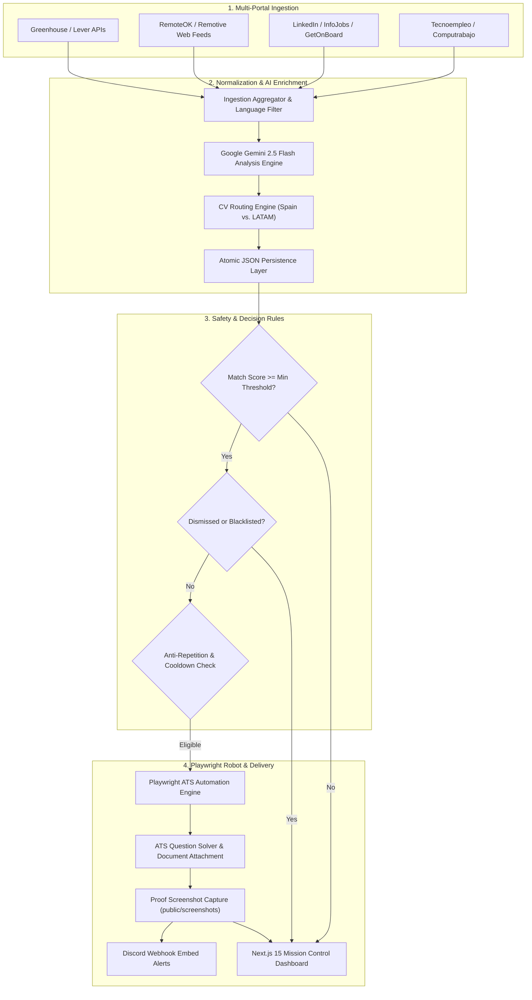

# 🌐 SIFT System — Autonomous Job Ingestion, AI Evaluation & Auto-Apply Platform

[](https://nextjs.org/)
[](https://react.dev/)
[](https://playwright.dev/)
[](https://tailwindcss.com/)
[](https://ai.google.dev/)
[](https://www.typescriptlang.org/)

**SIFT System** is an enterprise-grade, high-throughput autonomous job search, matching, and application infrastructure. Built upon **Next.js 15 App Router** and **React 19**, it systematically aggregates technical job opportunities across international hiring platforms, scores candidate compatibility using **Google Gemini 2.5 Flash**, routes geopolitical resume variations (**Spain / EU** vs. **Colombia / LATAM**), automates end-to-end ATS form submission via **Playwright**, and broadcasts real-time audit logs to **Discord**.

---

## 📖 1. Core Abstract & Functional Overview

SIFT System eliminates manual job searching and repetitive application procedures by running an event-driven automation engine paired with an executive mission control dashboard.

### 🌟 Feature Matrix

| Feature Domain | Capability | Description |
| :--- | :--- | :--- |
| **Multi-Portal Ingestion** | 9 Specialized Connectors | Concurrently extracts vacancies from **Greenhouse**, **Lever**, **LinkedIn**, **RemoteOK**, **Remotive**, **InfoJobs**, **GetOnBoard**, **Tecnoempleo**, and **Computrabajo**. |
| **Cognitive AI Matching** | Google Gemini 2.5 Flash | Synthesizes job specifications against candidate master profiles to calculate compatibility scores (0–100), identify missing competencies, highlight advantages, and draft tailored cover letters. |
| **Dual Geopolitical CV Routing** | Spain (EU) & Colombia (LATAM) | Dynamic dispatcher that assigns the legally compliant resume (`CV_ES` with EU work rights & EUR compensation or `CV_CO` for LATAM/US time zones) with audit justification. |
| **Headless ATS Automation** | Playwright Browser Engine | End-to-end form completion for Lever, Greenhouse, and LinkedIn Easy Apply, complete with automatic file uploads and intelligent ATS questionnaire resolution. |
| **Anti-Repetition & Cooldown** | Application State Guard | Enforces application deduplication, role/company cooldown periods, and dismissal blacklists to maintain applicant credibility. |
| **Real-Time Discord Webhooks** | Automated Embed Alerts | Dispatches rich embeds for newly identified high-match opportunities, automated application confirmations, and execution errors. |
| **Mission Control Dashboard** | Next.js 15 Executive UI | Comprehensive web interface featuring real-time KPI metrics, filterable job catalogs, interactive **Kanban boards** for application stage tracking, and CV profile administration. |

---

## 🚀 2. Architectural Runtime Flow



---

## 📁 3. Annotated Directory Tree

```text
sift-system/
├── .agents/                                # AI Architect configuration and skill protocols
│   ├── AGENTS.md                           # Enterprise Next.js 15 & React 19 standards
│   └── skills/                             # Modular engineering skill guides
├── public/                                 # Static public assets
│   ├── cv/                                 # Geopolitical CV artifacts (Spain & Colombia PDF/TXT)
│   │   ├── Diego_Villanueva_CV_Espana.pdf
│   │   ├── Diego_Villanueva_CV_Colombia.pdf
│   │   └── Diego_Villanueva_Carta_Presentacion.pdf
│   └── screenshots/                        # Playwright automated proof-of-application captures
├── src/
│   ├── app/                                # Next.js 15 App Router presentation layer
│   │   ├── api/                            # RESTful API route handlers
│   │   │   ├── ai/analyze/route.ts         # On-demand job evaluation with Gemini
│   │   │   ├── applications/route.ts       # Application querying & Kanban stage mutations
│   │   │   ├── apply/real/route.ts         # Real-world Playwright form execution
│   │   │   ├── apply/route.ts              # Simulated or staging application trigger
│   │   │   ├── cv/status/route.ts          # Active resume synchronization status
│   │   │   ├── cv/upload/route.ts          # Multi-profile PDF upload handler
│   │   │   ├── discord/test/route.ts       # Discord webhook connection diagnostic
│   │   │   ├── ingestion/run/route.ts      # Manual trigger for multi-source ingestion
│   │   │   ├── jobs/dismiss/route.ts       # Opportunity dismissal and blacklisting
│   │   │   ├── jobs/route.ts               # Ingested vacancies catalog endpoint
│   │   │   ├── scheduler/route.ts          # Automated ingestion & apply cycle controller
│   │   │   ├── session/launch/route.ts     # Headful browser interactive session spawner
│   │   │   ├── session/status/route.ts     # Active Playwright browser session status
│   │   │   └── settings/route.ts           # System parameters and thresholds handler
│   │   ├── applications/page.tsx           # Applications tracker (Kanban & Table views)
│   │   ├── cv-management/page.tsx          # Dual CV profile viewer and file manager
│   │   ├── jobs/page.tsx                   # Job board with filters, search, and detail drawer
│   │   ├── settings/page.tsx               # Webhook, threshold, and scheduler settings
│   │   ├── globals.css                     # Tailwind CSS v4 design tokens and utilities
│   │   ├── layout.tsx                      # Root application layout and navigation bar
│   │   └── page.tsx                        # Executive overview dashboard with KPI metrics
│   ├── modules/                            # Domain-driven backend modules
│   │   ├── ai-pipeline/                    # Gemini 2.5 Flash client, prompts, and analyzer
│   │   ├── auto-apply/                     # Application dispatcher and anti-repetition guard
│   │   ├── cv-engine/                      # Master candidate profile and CV routing logic
│   │   ├── discord-alerts/                 # Discord notification payload builder and sender
│   │   ├── ingestion/                      # Multi-portal ingestion connectors & filters
│   │   │   └── connectors/                 # Connector adapters (Greenhouse, Lever, LinkedIn, etc.)
│   │   ├── jobs/                           # Job aggregation and query service
│   │   ├── playwright-engine/              # Automated browser runner, session manager & fillers
│   │   │   └── formFillers/                # Specialized ATS fillers (Lever, Greenhouse, LinkedIn)
│   │   ├── scheduler/                      # Background interval daemon service
│   │   └── storage/                        # Atomic JSON persistence service
│   └── shared/                             # Atomic design system and reusable utilities
│       ├── lib/utils.ts                    # Class name merging utility (clsx + tailwind-merge)
│       ├── types/index.ts                  # Canonical TypeScript domain interfaces
│       └── ui/                             # Atomic UI component library
│           ├── atoms/                      # Button, Badge, Card, Input, MatchScorePill, Switch
│           ├── molecules/                  # FormField, RegionSelector, ScoreBreakdown, StatCard
│           └── organisms/                  # ApplicationTable, JobCard, JobDetailDrawer, KanbanBoard
├── storage/                                # File-based JSON data stores
│   ├── applications.json                   # Executed applications record and audit history
│   ├── dismissed_jobs.json                 # Dismissed job vacancy registry
│   ├── jobs.json                           # Ingested and AI-scored vacancies
│   └── settings.json                       # System settings and threshold configuration
├── .env.example                            # Environment variables blueprint
├── next.config.ts                          # Next.js 15 engine configuration
├── package.json                            # Package manifest and dependency definitions
├── postcss.config.mjs                      # PostCSS pipeline for Tailwind CSS v4
└── tsconfig.json                           # TypeScript compiler strict configuration
```

---

## 🛠️ 4. Technical Stack & Dependencies

All dependencies are pinned to semantic versions aligned with Next.js 15 and React 19:

### Core Framework & Runtimes
| Package | Version | Purpose |
| :--- | :--- | :--- |
| [`next`](https://www.npmjs.com/package/next) | `^15.2.0` | React server-first framework with App Router architecture |
| [`react`](https://www.npmjs.com/package/react) | `^19.0.0` | Declarative UI library with Server Components (RSC) |
| [`react-dom`](https://www.npmjs.com/package/react-dom) | `^19.0.0` | DOM bindings for React 19 |
| [`typescript`](https://www.npmjs.com/package/typescript) | `^5.8.2` | Static type safety and strict compiler checks |

### AI, Automation & Networking
| Package | Version | Purpose |
| :--- | :--- | :--- |
| [`@google/genai`](https://www.npmjs.com/package/@google/genai) | `^2.22.0` | Official Google Gemini SDK for job analysis and ATS solver |
| [`playwright`](https://www.npmjs.com/package/playwright) | `^1.63.0` | Headless Chromium engine for ATS submission and screenshot proof |

### Styling & Visual Primitives
| Package | Version | Purpose |
| :--- | :--- | :--- |
| [`tailwindcss`](https://www.npmjs.com/package/tailwindcss) | `^4.0.9` | Next-generation utility-first CSS styling engine |
| [`@tailwindcss/postcss`](https://www.npmjs.com/package/@tailwindcss/postcss) | `^4.0.9` | PostCSS plugin integration for Tailwind CSS v4 |
| [`clsx`](https://www.npmjs.com/package/clsx) | `^2.1.1` | High-performance conditional class name constructor |
| [`tailwind-merge`](https://www.npmjs.com/package/tailwind-merge) | `^3.0.2` | Resolves conflicting Tailwind CSS utility classes |
| [`lucide-react`](https://www.npmjs.com/package/lucide-react) | `^1.16.0` | Crisp, accessible icons for dashboards and metrics |

---

## ⚙️ 5. Provisioning & Setup Guide

### Prerequisites
- **Node.js**: `v20.x` or higher (LTS recommended)
- **Package Manager**: `npm` (v10+) or `pnpm` (v9+)
- **Operating System**: macOS, Linux, or Windows (WSL2 recommended for Playwright)

### Quickstart Installation

```bash
# 1. Clone repository
git clone https://github.com/DiegoVilla27/sift-system.git
cd sift-system

# 2. Install project dependencies
npm install

# 3. Install Playwright browser binaries and system dependencies
npx playwright install --with-deps chromium

# 4. Configure environment variables
cp .env.example .env.local
```

### Environment Configuration (`.env.local`)

Open `.env.local` and define your operating credentials:

```bash
# Google Gemini API key for automated job evaluation and match scoring
GEMINI_API_KEY="your-google-gemini-api-key"

# Discord Webhook URL for real-time notification alerts
DISCORD_WEBHOOK_URL="https://discord.com/api/webhooks/your-webhook-id/your-webhook-token"

# Branding and application identity
NEXT_PUBLIC_APP_NAME="Sift System"

# Playwright execution mode: set to 'true' for background operation, 'false' for visual debugging
PLAYWRIGHT_HEADLESS=true
```

### Execution Scripts

```bash
# Run local development server with Turbopack (http://localhost:3000)
npm run dev

# Compile production-ready bundle
npm run build

# Launch production server
npm start

# Run ESLint validation
npm run lint
```

---

## 🔌 6. RESTful API Reference

The internal backend operates via Next.js Route Handlers:

| Endpoint | Method | Domain | Description |
| :--- | :--- | :--- | :--- |
| `/api/jobs` | `GET` | Catalog | Returns all ingested jobs, sorted by match score with support for search and regional filters. |
| `/api/jobs/dismiss` | `POST` | Catalog | Blacklists a job vacancy to prevent future evaluation or automated application. |
| `/api/ingestion/run` | `POST` | Ingestion | Triggers synchronous multi-portal scraping across all 9 connectors. |
| `/api/ai/analyze` | `POST` | AI Pipeline | Evaluates a custom job description using Gemini 2.5 Flash and returns match analysis. |
| `/api/applications` | `GET`, `PATCH` | Applications | Fetches all tracked applications or updates an application stage (**APPLIED**, **INTERVIEW**, **OFFER**, etc.). |
| `/api/apply` | `POST` | Auto-Apply | Dispatches an application using default test execution logic. |
| `/api/apply/real` | `POST` | Auto-Apply | Executes real-world Playwright form submission (Lever, Greenhouse, LinkedIn Easy Apply). |
| `/api/cv/status` | `GET` | CV Engine | Verifies physical existence and metadata of Spain (`CV_ES`) and Colombia (`CV_CO`) PDF assets. |
| `/api/cv/upload` | `POST` | CV Engine | Uploads or replaces CV PDF files directly into the active storage and public paths. |
| `/api/scheduler` | `GET`, `POST` | Scheduler | Queries daemon status or triggers an immediate scheduler cycle tick. |
| `/api/session/launch` | `POST` | Playwright | Launches an interactive headful browser window for manual intervention and authentication. |
| `/api/session/status` | `GET` | Playwright | Reports the current state of active browser sessions. |
| `/api/settings` | `GET`, `POST` | Settings | Retrieves or updates system settings (minimum affinity score, webhook URL, auto-apply toggle). |
| `/api/discord/test` | `POST` | Discord | Dispatches a diagnostic test notification embed to verify webhook connectivity. |

---

## 📈 7. Performance, Safety & Resilience

- **Anti-Repetition Cooldown Guard**: The system maintains an index of applied vacancies. Re-applications to the same company or identical requisition URL are blocked for a configurable 30-day cooldown window.
- **Cycle Rate Limiting**: The background scheduler enforces a strict throttle limit of **maximum 2 auto-applications per cycle** to prevent anti-bot IP flagging and maintain quality.
- **Proof-of-Application Archival**: Each Playwright execution automatically captures high-resolution viewport screenshots upon form completion, preserved in `public/screenshots/` with timestamps for verification.
- **Atomic File Storage**: Ingestion and application records are saved atomically to `storage/*.json` files to guarantee state persistence without external database overhead.

---

> This digital ecosystem has been designed, structured, and developed to high-performance standards by **[Cabuweb](https://cabuweb.com)** - **Software Developer: Diego Villa**.
